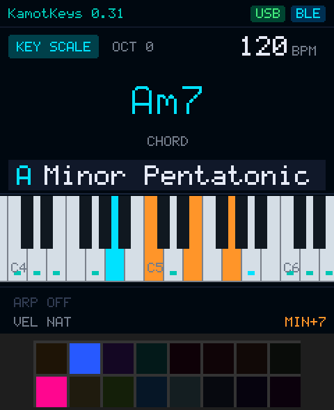
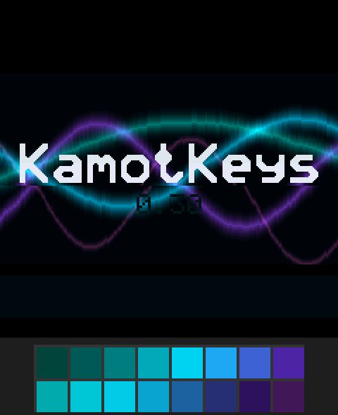
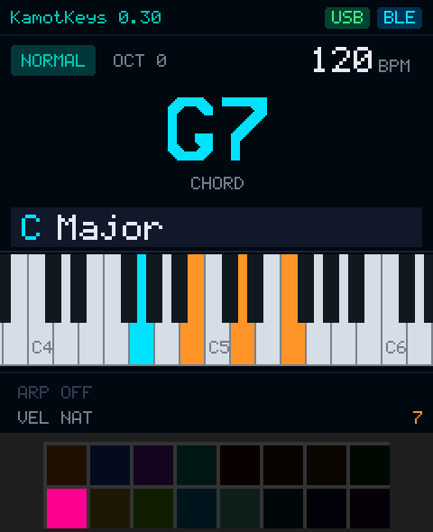
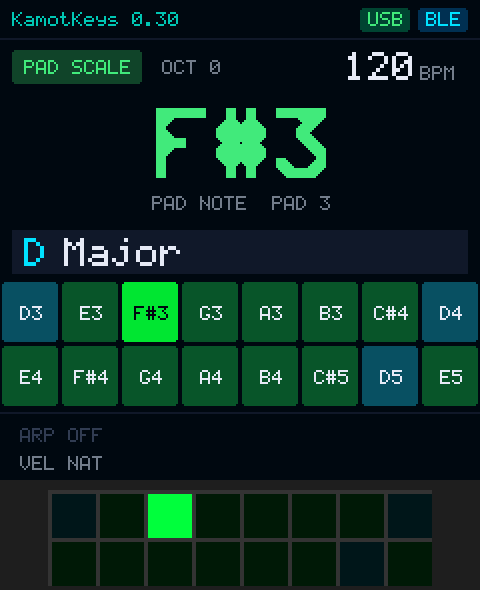
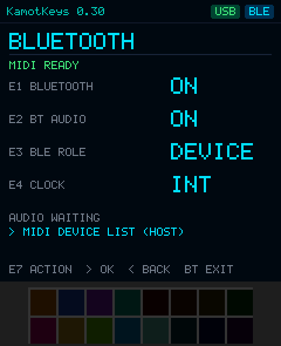

# KamoteKeys for M-VAVE SMK-37 Pro / Elite and FM-1

KamoteKeys is a performance firmware for M-VAVE keyboards: chord pads, a scale-remapped keyboard, 16-pad scale and drum modes, Ableton clip launching, ARP, a SUSTAIN button, Ableton Live transport buttons, an animated piano display and BLE/USB MIDI. **One codebase builds all three firmwares:**

| Device | Built on | Build | Guide |
|---|---|---|---|
| SMK-37 Pro | SMK37 OPEN V01 | `build.bat smk37-pro --package` | this README |
| SMK-37 Elite | SMK37 OPEN V01 | `build.bat smk37-elite --package` | this README |
| FM-1 | FM1 OPEN V14 | `build.bat fm1 --package` | [docs/FM1.md](docs/FM1.md) (chord keys, white keys as pads, SMK-37 button layout) |

> **Status: development snapshot.** SMK-37: built and used on an SMK-37 Pro (pad LEDs and Clip Mode confirmed). FM-1: flashed and running (0.49). Elite: built from the same code but not yet run on hardware. PC tests: SMK-37 unit/fuzz checks, SMK-37 and FM-1 integration checks against each device's real engine in its browser simulator, Remote Script tests (`tools/test-all.sh`). See [Hardware validation](#hardware-validation).

## One codebase

```
core/                 KamoteKeys itself, one copy for every device:
  kk_controls.c         performance core: modes, chords, ARP, Sustain, buttons, settings
  screen.c              LCD: pages, piano, pad map, Bluetooth menu, boot
  kamotkeys/            music theory, MIDI engine, LED logic, configuration
devices/smk37/        SMK37 OPEN V01 + SMK-37 glue (pad scanner, RGB pads, faders)
devices/fm1/          FM1 OPEN V14 + FM-1 glue (split keyboard, key LEDs)
  app/kamotkeys/kk_device.h   the device's sizes, labels and feature switches
remote_script/        Ableton Remote Script (all devices)
tests/, docs/         tests and documentation
build.bat             build.bat smk37-pro | smk37-elite | fm1 [--package]
```

- **Change features in `core/`.** Every device gets the change on its next build: `build.bat` copies `core/` into the device tree (`tools/Sync-Core.ps1`; on Linux/macOS `tools/sync-core.sh`) and then runs that device's unmodified vendor build. The copies inside `devices/*/app` are git-ignored; don't edit them.
- **Device differences** live in `devices/<device>/app/kamotkeys/kk_device.h` (key count, key-to-note anchor, default octave, fixed velocity, knob labels) and a few clearly marked `#ifdef KK_DEVICE_FM1` / `KK_DEVICE_SMK37` blocks in the core (FM-1 HOME/SAVE buttons, device settings bytes, diagnostics page).
- **Hardware code** stays in each device tree: SMK-37 `app/board/scan.c`, `panel.c`, `kamotkeys/kk_led_rgb.c`; FM-1 `app/kamotkeys/kk_fm1_input.c`. Each vendor SDK (`devices/*/sdk`) is hash-locked and unmodified.
- **Test everything:** `tools/test-all.sh` (set `WASI_SDK` to also run both browser-simulator suites).

The rest of this README describes the **SMK-37**. The FM-1 has no pads or faders; its key layout, buttons and knobs are in [docs/FM1.md](docs/FM1.md).



## Contents

- [Hardware compatibility](#hardware-compatibility)
- [Controls at a glance](#controls-at-a-glance)
- [Faders](#faders)
- [Performance modes](#performance-modes)
- [ARP and Sustain](#arp-and-sustain)
- [Knobs (encoders)](#knobs-encoders)
- [Screens](#screens)
- [RGB and button lighting](#rgb-and-button-lighting)
- [Bluetooth and USB MIDI](#bluetooth-and-usb-midi)
- [Ableton Live setup](#ableton-live-setup)
- [Saved settings](#saved-settings)
- [Build](#build) · [Flash](#flash) · [Recovery](#recovery)
- [Hardware validation](#hardware-validation)
- [Project layout](#project-layout)
- [License and attribution](#license-and-attribution)

Detailed references: [MIDI mapping](docs/MIDI_MAPPING.md) · [Button and pad diagrams](docs/CONTROLS.md) · [Build, flash and recovery](docs/BUILD_FLASH_RECOVERY.md) · [Tests and verification](docs/TESTING.md) · [Changelog](CHANGELOG.md)

## Hardware compatibility

| Model | Status |
|---|---|
| SMK-37 Pro | `build.bat smk37-pro`. Built and used on hardware. |
| SMK-37 Elite | `build.bat smk37-elite`. Same SMK37 OPEN board driver; not yet run on hardware. |
| FM-1 | `build.bat fm1`. See [docs/FM1.md](docs/FM1.md); not yet run on hardware. |

Both models need SMK37 OPEN's update path (the model-specific workbench page). Pro and Elite packages are **not** interchangeable. The firmware keeps SMK37 OPEN's update identity (`SMK-37 Pro_8000001` / `SMK-37 Elite_8000001`, release `V01`) so the official workbench recognises the device. The KamoteKeys version is a separate constant, `KAMOTKEYS_VERSION` in [`core/kamotkeys/kk_config.h`](core/kamotkeys/kk_config.h) (one version for all devices; the FM-1 build shows it as e.g. `0.59-FM1`).

## Controls at a glance

Diagrams: [all controls](docs/diagrams/SMK37-Controls.png) · [every control in every mode](docs/diagrams/SMK37-Modes-Table.png) · [play modes](docs/diagrams/SMK37-Play-Modes.png) · [Clip Mode](docs/diagrams/SMK37-Clip-Mode.png) · [Step Mode](docs/diagrams/SMK37-Step-Mode.png) · [startup](docs/diagrams/SMK37-Boot.gif)

```
 LEFT BLOCK                         RIGHT BLOCK
 ┌────────────┬────────────┐        ┌──────┬────────────┬───────┬───────┬───────┬──────┐
 │ KNOB BANK  │ FADER BANK │        │ ARP  │ NOTE REPEAT│ SCALE │ CHORD │ GLOBE │  BT  │
 │ Sess.Rec * │ Capture *  │        │ arp  │ sustain    │ PadScl│ Clip  │ Stop  │ menu │
 ├────────────┼────────────┤        ├──────┼────────────┼───────┼───────┼───────┼──────┤
 │   ◀ LEFT   │  RIGHT ▶   │        │PATCH │   PARA     │  FX   │  SEQ  │ PLAY  │ REC  │
 │ HOME/Undo  │  Redo      │        │patch │ Play/Pause │ Drum  │KeyScl │ Start │ Step │
 ├────────────┼────────────┤        └──────┴────────────┴───────┴───────┴───────┴──────┘
 │   OCT −    │   OCT +    │        * both held = light show, 3 s = ripple lights
 └────────────┴────────────┘
```

| Button | Short press | Hold |
|---|---|---|
| ARP | ARP on/off | 0.6 s: ARP settings page |
| NOTE REPEAT | **SUSTAIN** on/off: notes hold until the next key; with ARP on it latches the arpeggio | |
| SCALE | Pad Scale Mode on/off | |
| CHORD | **Clip Mode** on/off (8 × 2 Ableton clip launcher) | 0.6 s: **Step Mode** (same as SEQ REC) |
| GLOBE | Ableton **Stop** (CC 21) | |
| BT | Open/close the Bluetooth menu | 1.5 s: diagnostics |
| PATCH | Open/close the patch page | |
| PARA | Ableton **Play/Pause** (CC 23: continues from where it stopped) | |
| PATCH + PARA (or ◀ + PARA) | Ableton **metronome** on/off (CC 26) | |
| FX | Drum Mode on/off | |
| SEQ | Key Scale Mode on/off | |
| SEQ PLAY | Ableton **Start** (CC 20) | |
| SEQ REC | **Step Mode** on/off (drum step sequencer) | |
| KNOB BANK | Ableton **Session Record** (CC 25, sent on release) | |
| FADER BANK | Ableton **Capture MIDI** (CC 22, sent on release) | |
| KNOB BANK + FADER BANK | **Light show** while held; each new press = next pattern | 3 s: **ripple lights** on/off |
| ◀ LEFT (HOME) | Ableton **Undo** (CC 24, sent on release so ◀ + PARA can toggle the metronome). In the BT menu: HOME (back) | |
| RIGHT ▶ | Ableton **Redo** (CC 27). In the BT menu: SAVE (OK) | |
| OCT − / OCT + | Octave −4 … +4. Keyboard starts at **−2**; in Pad Scale/Drum Mode they move the pad octave (starts at 0) | |

All Ableton commands are on **MIDI channel 15**. The pad map and the button-index verification are in [docs/CONTROLS.md](docs/CONTROLS.md).

## Faders

| Fader | Function |
|---|---|
| 1 | **Velocity.** 0–10 %: natural key/pad velocity. Above 10 %: fixed velocity proportional to position, 100 % = 127. Applies to keys, Key Scale, Pad Scale, Drum pads and ARP. It is read at Note On only and never changes sounding notes or Note Off. **During the light show:** its speed. |
| 2 | **Scale** (23 scales, bottom = Major, top = Minor 6-Diminished), with 2-count hysteresis against ADC noise. |
| 3 | **Root key** C … B, with hysteresis. |
| 4 | **Pad brightness** multiplier: 0 % = pads fully off, 50 % = half, 100 % = full. At ≤ 10 % the LCD also drops to half apparent brightness (software dimming). |

Scales: Major, Natural Minor, Dorian, Phrygian, Lydian, Mixolydian, Locrian, Harmonic Minor, Melodic Minor, Major Pentatonic, Minor Pentatonic, Blues, Phrygian Dominant, Double Harmonic, Hirajoshi, Whole Tone, Diminished Whole-Half, Diminished Half-Whole, Bebop Dominant, Bebop Major, Bebop Minor, 6-Diminished, Minor 6-Diminished. One shared engine ([`kk_theory.c`](core/kamotkeys/kk_theory.c)) serves the keys, pads, chords, LEDs and display.

## Performance modes

The modes are mutually exclusive. Pressing a mode button switches to that mode; pressing the active one returns to **Normal**. Each switch releases the notes it affects.

### Normal Mode (default)

- **Keyboard:** chromatic, channel 1. At the power-on octave −2 the lowest key is C1 (MIDI 24); at octave 0 it is C3 (48).
- **Chord pads** (pads 1–4, 9–13) are modifiers: hold one or more, then play a key. The chord root follows the key you play.

  | Pad | Modifier | Pad | Modifier |
  |---|---|---|---|
  | 1 | MAJ (triad) | 9 | 7 (adds ♭7, or the diatonic 7th) |
  | 2 | MIN | 10 | MAJ7 |
  | 3 | DIM | 11 | 6 |
  | 4 | SUS4 | 12 | 9 (adds 9th; with 7/MAJ7 gives 9 chords) |
  |   |   | 13 | **LOCK**: latch the held modifiers (see below) |

  **LOCK (pad 13):** hold your modifiers and tap 13 → they stay on after you let go, so one hand plays chords from the keys. While locked, tapping a pad **switches** within its row: MIN replaces MAJ (pads 1–4), 9 replaces 7 (pads 9–12). Pads of the same row combine only when pressed while another of that row is held; tapping the active pad clears its row. Tap 13 again to unlock. Pad 13 and the latched modifiers stay lit. **The lock stays on in every mode** (only the LOCK pad releases it), so you can lock a chord, pick a scale and play locked chords on the scale keys, or keep playing the locked chord from the keys in Drum, Pad Scale, Clip or Step Mode.

  **Colours:** top row by chord mood (MAJ warm amber, MIN blue, DIM purple, SUS4 teal); bottom row extensions in one magenta→pink family (7, MAJ7, 6, 9 getting lighter); LOCK white.

  Holding only extension pads (9–12) builds the chord **diatonically** from the selected scale and root: in C major, 7 on G gives G7 and 7 on B gives Bm7♭5. Changing modifiers while keys are held re-voices those keys: common tones keep sounding, the others stop or start.
- **Spare pads** 5–8 and 14–16 are **mappable buttons**: CC 102–108 on channel 15, 127 on press and 0 on release (map them in Ableton with ⌘M). Each has its own colour and lights while held.

### Key Scale Mode (SEQ)

The **second physical C** plays the selected tonic, at octave 0 the tonic in the octave starting at C4 (e.g. A → A4 = 69). Successive white keys play successive scale degrees, upwards and **downwards**. Pentatonic and 6/8-note scales wrap correctly. Black keys are silent. Chord pads and spare pads work as in Normal Mode.

| Physical key | A Major | A Minor Pentatonic |
|---|---|---|
| C (lowest) | A3 | E3 |
| … | … | … |
| B below anchor | G♯4 | G4 |
| **2nd C (anchor)** | **A4** | **A4** |
| D | B4 | C5 |
| E | C♯5 | D5 |
| F | D5 | E5 |
| G | E5 | G5 |
| A | F♯5 | A5 |
| B | G♯5 | C6 |
| next C | A5 | D6 |

### Clip Mode (CHORD)

Pads 1–8 launch clip 1 and pads 9–16 clip 2 of Live tracks 1–8, on channel 16, with LEDs that follow Live (empty very dim, stopped dim blue, playing green, queued blinking amber, recording red). Needs the [KamoteKeys Remote Script](docs/ABLETON_REMOTE_SCRIPT.md). A plain pad press **selects** the slot and arms its track (so KNOB BANK records there); the **F#** key toggles pads to **play** (launch / stop), remembered after power-off. Hold the **lowest C** + a clip to **overdub** into it. Lowest black keys: **C# COPY**, **D# PASTE** (tap = next pad, hold = several), F# select ↔ play, **G# Scene Arrange** (tap pads to choose which tracks play in each scene; top F# launches exactly those), **A# DELETE** (hold + clip); white **top A / B** move the 8-track view; top **F# / G# / A#** = scene launch / up / down. The screen shows what is copied. Live's highlighted slot is **violet**. Full guide: [docs/ABLETON_REMOTE_SCRIPT.md](docs/ABLETON_REMOTE_SCRIPT.md), [diagram](docs/diagrams/SMK37-Clip-Mode.png).

### Step Mode (SEQ REC, or hold CHORD)

A step sequencer that writes straight into the selected session clip in Live, laid out like Ableton Move: 16 pads = 16 steps per page; the **second octave = drum keys** (C = kick … B): a key plays its sound and selects it for the steps. **OCT −/+** moves those keys by an octave and **SEQ** turns them into scale keys (for melodic tracks); both are remembered per track. The **lowest octave = controls** (white: RESOLUTION, FOLLOW, DRUM, LENGTH + pad = bars, BARS; black: COPY, PASTE, page ◀ ▶, DELETE); **PARA** makes and plays / stops the clip; leaving Step Mode returns to the mode you came from; the key zone runs from C2 to E3; **top F G A B = velocity 32 / 64 / 96 / 127**, **hold the top C** to set the note length on the pads, the **top three black keys = 1× / 2× / 3× repeats** (hold + a pad). A chord locked on the main screen is written into the steps as a chord. Other sounds on a step show as a violet tint; the screen shows the bar the clip is playing. The sequenced track is armed while Step Mode is on. Needs the Remote Script; full guide in [docs/ABLETON_REMOTE_SCRIPT.md](docs/ABLETON_REMOTE_SCRIPT.md#step-mode-drum-step-sequencer-058).

### Pad Scale Mode (SCALE)

All 16 pads play consecutive scale degrees in pad order (pad 1 = tonic at octave 3, e.g. D3), following Fader 2/3 and the octave buttons. Channel 1. Root pads are **cyan** and the other pads **green**, both dim when idle and bright when pressed. The screen shows the note, root, scale and octave in a 2 × 8 pad map. The keyboard keeps playing chromatically.

### Drum Mode (FX)

All 16 pads send drum notes on **channel 10**. The layout is vertical: pad 1 = 36, pad 9 = 37, pad 2 = 38, and so on (full table in [docs/MIDI_MAPPING.md](docs/MIDI_MAPPING.md)). Octave buttons transpose by 12, so pad 1 is 24 at −1 and 48 at +1. Out-of-range pads are disabled. Pads are coloured by the GM family of the note they currently play: kick red, snare orange, hi-hat yellow, toms blue, rim purple, clap pink, cymbals teal, other percussion green. The internal sound comes from track 8's drum engine; KamoteKeys keeps that track on a drum source so channel 10 never plays the melodic synth.

## ARP and Sustain

**ARP** (short press of ARP). One clock, the shared BPM.

- Normal and Key Scale: arpeggiates held keys, including generated chords.
- Pad Scale: arpeggiates held pads (channel 1). Drum: arpeggiates held drum pads (channel 10).
- Parameters (ARP page, or the main-screen knobs): **Mode** NORMAL/LATCH, **Direction** UP, DOWN, UP-DOWN, RANDOM, ORDER (as played), **Division** 1/4, 1/8, 1/8T, 1/16, 1/16T, 1/32 (default 1/8), **Gate** 10–100 % (default 75 %), **Swing** 0–50 %, **Octaves** 1–4.
- Toggling ARP while notes are held moves them safely between direct play and the arpeggiator.

**Sustain** (the NOTE REPEAT button, 0.54): tap to turn it on (LED bright, SUSTAIN in the status line), tap again to turn it off.
- When you let go, the notes **keep sounding until you press the next key** (or pad); that next key ends them and plays.
- Keys **pressed together, or added while others are still held, are sustained together**.
- Chord-modifier pads (MAJ, MIN, …) do not end the held notes; a mode change or Sustain off releases them.
- KamoteKeys holds the notes itself, so the synth and Ableton see long notes (no CC 64). A real **sustain pedal** still sends CC 64.
- **With ARP on**, the same rule latches the arpeggio: it keeps playing after you let go, and the next key or chord replaces it.

KamoteKeys turns off the SMK37 OPEN engine's own per-track ARP so that notes are never doubled.

## Knobs (encoders)

Encoders are numbered E1–E8, left to right; SMK37 OPEN calls them K1–K4, SELECT, PAGE, PRESET, MASTER.

| Knob | Main screen | ARP page | Patch page | BT menu |
|---|---|---|---|---|
| E1 | BPM (30–300) | Mode | Patch | Bluetooth on/off |
| E2 | Patch (DX7 1–128) | Direction | Internal synth on/off | BT audio on/off |
| E3 | ARP division | Division | MIDI OUT ports | BLE role DEVICE/HOST |
| E4 | ARP gate | Gate | Pad sensitivity 1–7 | Clock INT/MIDI |
| E5 | ARP direction | Swing | | Host list: device |
| E6 | ARP swing | Octaves | | |
| E7 | — | | | Action |
| E8 | **Master volume** (always) | | | |

Changes on the main screen appear as a short message in the status line.

## Screens

| | |
|---|---|
|  | **Aurora boot** (~1.1 s): flowing teal, cyan, purple and pink ribbons, the KamoteKeys wordmark, the version and a start-up line, drawn in a fixed band and never full-screen per frame. The pads show an Aurora Flow gated by Fader 4, then fade into the normal colours. |
|  | **Main screen:** version label, mode, octave, BPM, the chord or note name, root and scale, the piano, and ARP/Sustain/velocity status. The piano follows the **actual MIDI note list**: a single note lights one key (green); in a chord the root is cyan and the other tones orange. The view re-centres with a ~110 ms ease-out pixel scroll that can redirect mid-move. Key Scale Mode adds dots for scale degrees. |
|  | **Pad Scale / Drum:** a 2 × 8 pad map with note names or drum labels and live highlights. |
|  | **Bluetooth menu:** SMK37 OPEN's standard menu (see below). |

More: [ARP page](docs/screenshots/11_arp_page.png), [Patch page](docs/screenshots/10_patch_page.png), [Diagnostics](docs/screenshots/13_diagnostics.png) (no KamoteKeys branding), [dimmed LCD](docs/screenshots/14_main_dimmed.png), [light-show patterns](docs/screenshots/15_lightshows.png).

## RGB and button lighting

A single renderer ([`kk_led.c`](core/kamotkeys/kk_led.c), RGB output in [`kk_led_rgb.c`](devices/smk37/app/kamotkeys/kk_led_rgb.c)) decides every pad's colour and level (mode colour, then idle/pressed level, then the Fader 4 multiplier) and hands it to the board driver. Levels: chord pads 25 % at rest, spare (CC) pads 12.5 % (half the chord pads), scale/drum pads 22 % (Pad Scale roots 50 %), 100 % when pressed or sounding. Starting or ending a light show crossfades over ~0.2 s. The peak is 160/255, scaled by Fader 4, and every channel value is rounded to a multiple of 4 (see below).

**How the pads are driven (lessons from hardware testing on an SMK-37 Pro):**
- Root cause (0.41): the gap in front of each pad frame (SMK37 OPEN: 36 zero bytes, about 45 us) was shorter than the LEDs' reset time (about 280 us), so a stray pulse when the shared SPI line switched from the LCD to the pads shifted the whole frame by a bit. Pad 1 blinked green, and colour bits spilled between pads at the start and end of the chain. KamoteKeys drives the line low before switching and sends 320 zero bytes (about 400 us) before every frame.
- Channel values are still rounded to multiples of 4 (a lit channel is at least 4), which made the remaining errors harmless before the root cause was found.
- A low peak brightness (64) left the dim idle colours too few steps to keep their hue, so the peak is 160.
- Changed colours go out at once and the whole frame is resent every 25 ms (at most 50 frames per second).
- The LED bit timing can be chosen on the Diagnostics page (E2, 8 presets, saved; 0 = SMK37 OPEN original, and all presets worked on the test unit).

Button LEDs are single-colour on/off LEDs. KamoteKeys adds a **dim** level (1/8 duty in the existing LED multiplex interrupt):

- enabled buttons are dim when idle and bright while pressed;
- ARP, NOTE REPEAT (Sustain), SCALE, SEQ, FX and CHORD stay bright while their function or mode is active, and **SCALE shows only Pad Scale, SEQ shows only Key Scale**;
- KNOB BANK and FADER BANK light while pressed or while the light show runs; SEQ REC in Step Mode; BT while its menu is open;

**Ripple lights**: **hold KNOB BANK + FADER BANK for 3 s** to toggle them (0.57–0.58: three taps on SEQ REC). The pads and keys keep working normally, and every press sends a coloured ring across the pads from where you pressed (keys map left to right onto the pad columns). Not saved.

**Light show** (hold KNOB BANK + FADER BANK together; each new press of the second one selects the next pattern; nothing is sent to Ableton): Rainbow sweep, Vertical pulse, Spiral/perimeter chase, Checkerboard, Diagonal wave, Breathing colours, Opposing chases, Colour wave. While it runs the pads send no MIDI, Fader 1 sets the speed (about 0.03–2 cycles per second; 0 % = 1 per second) and Fader 4 the brightness. Changing the speed never restarts the pattern.

## Bluetooth and USB MIDI

KamoteKeys uses SMK37 OPEN's native transports unchanged: USB MIDI and BLE MIDI. In DEVICE (peripheral) mode the device advertises as `SMK37 Pro Open_BLE` / `SMK37 Elite Open_BLE`.

**BT button → the standard SMK37 OPEN Bluetooth menu:**

- E1 Bluetooth on/off, E2 BT audio, E3 BLE role DEVICE/HOST, E4 clock INT/MIDI;
- E7 selects the action (`MIDI DEVICE LIST (HOST)` / `FORGET MIDI PAIRS`); **RIGHT ▶ = OK (SAVE)**, **◀ LEFT = back (HOME)**, BT = exit;
- in the host list: E5 selects a device, E7 chooses CONNECT / SCAN / DISCONNECT / SETTINGS, ▶ confirms;
- forgetting pairs asks for confirmation (▶ yes, ◀ no). Remove the old entry on the computer too.

While the menu is open, ◀ and ▶ do not send Undo/Redo, and their releases are swallowed as well.

**Pairing on a Mac:** open *Audio MIDI Setup → Window → Show MIDI Studio → Bluetooth* (the BLE configuration icon), find `SMK37 … Open_BLE` and press **Connect**.

**Output ports (Patch page, E3 MIDI OUT):**

| Setting | Behaviour |
|---|---|
| **AUTO** (default) | USB if USB MIDI is connected, otherwise BLE. A Mac connected both ways never receives each command twice. |
| ALL | USB and BLE (and DIN where fitted). |
| USB / BLE | That port only. |

Note Offs always go to every port, so a port change between Note On and Note Off cannot leave a stuck note. The router also releases notes on a port that disconnects. The engine's MIDI clock output follows SMK37 OPEN's settings.

## Ableton Live setup

1. *Settings → Link, Tempo & MIDI.* Enable **Track** for the KamoteKeys input you use (USB *or* Bluetooth).
2. Install the [KamoteKeys Remote Script](docs/ABLETON_REMOTE_SCRIPT.md) and select it as a Control Surface with Input and Output on the keyboard's port. It handles Clip Mode and these buttons without any MIDI mapping:

   | Live action | Button | CC (ch. 15) |
   |---|---|---|
   | Play | SEQ PLAY | 20 |
   | Stop | GLOBE | 21 |
   | Capture MIDI | FADER BANK | 22 |
   | Play/Pause | PARA | 23 |
   | Undo | ◀ (on release) | 24 |
   | Metronome | PATCH + PARA (or ◀ + PARA) | 26 |
   | Session Record | KNOB BANK | 25 |
   | Redo | ▶ | 27 |

   Buttons send 127 on press and 0 on release. Remove old manual mappings of these buttons, or each press acts twice. Without the script you can still MIDI-map the buttons (⌘M).
3. **Avoid duplicates:** with MIDI OUT on AUTO, only one port carries data. If you choose ALL, enable Track/Remote for **only one** of the USB and Bluetooth inputs in Live, otherwise every note and command arrives twice.
4. Keys and scale/spare pads use channel 1 and drums channel 10. Set a track's MIDI From to *All Channels* or to the specific channel.
5. To hear only Live, turn **Internal synth** off on the Patch page (E2), or turn MASTER (E8) down.

## Saved settings

Saved automatically, about 1.5 s after the last change and only while nothing is playing, in SMK37 OPEN's journaled settings sector: **BPM, ARP on/off, mode, direction, division, gate, swing, octaves, DX7 patch, MIDI OUT ports, internal synth on/off, pad LED timing, pad sensitivity**. The **octave is not saved**: keys start at −2 and pads at 0 on every power-on. Scale, root, velocity and brightness come from the physical faders. Bluetooth settings are stored by SMK37 OPEN as before.

## Build

Windows x64 with PowerShell and the [JieLi 2.5.3 Windows toolchain](https://jl-update.oss-cn-shenzhen.aliyuncs.com/2.5.3.exe) (PI32v2 clang 4.0.1, `r3`), exactly as SMK37 OPEN / FM1 OPEN. Each SDK manifest verifies the toolchain and SDK hashes; do not modify `devices/*/sdk/`.

```powershell
cd C:\path\to\kamotekeys-<version>                    # a local C: folder, not \\Mac\... (cmd cannot run there)
$env:FM1_PI32_TOOLCHAIN = 'C:\JL\pi32'
$env:FM1_SOURCE_URL = 'https://localhost/kamotekeys-source.zip'       # any https URL; publish the real source if you share builds
.\build.bat smk37-pro --package                     # or smk37-elite, or fm1
```

Needs the x64 Visual C++ Redistributable (for the bundled web compiler) and, on first run, downloads WASI SDK 27 (set `FM1_WASI_SDK` to reuse it). Every release zip has a `BUILD.txt` with copy-and-paste PowerShell blocks for Parallels (made by `tools/release.sh`).

Outputs (the offline workbench with the KamoteKeys firmware embedded): `devices\smk37\build\official-web\pro\SMK37-Open-Source.html` (or `...\elite\...`) and `devices\fm1\build\official-web\FM1-Official-Open-Source.html`. The build log prints the image, VM and user sizes and stops if the package exceeds 1 MiB. Firmware image alone: run `tools\Sync-Core.ps1 -Device smk37`, then `devices\smk37\sdk\Build.ps1 -Model pro -FirmwareOnly -Toolchain 'C:\JL\pi32'`. Full details: [docs/BUILD_FLASH_RECOVERY.md](docs/BUILD_FLASH_RECOVERY.md).

PC-side tests (no toolchain needed): `tools/test-all.sh`; see [docs/TESTING.md](docs/TESTING.md).

## Flash

1. Back up projects, voices and samples with the official SMK37 OPEN workbench first.
2. Open `SMK37-Open-Source.html` for **your** model in desktop Chrome or Edge, connect USB and allow MIDI/SysEx.
3. Use **Device update**: **Start update** when the keyboard already runs SMK37 OPEN/KamoteKeys; tick **Force flash** only when coming from M-VAVE stock V16. Firmware based on other projects (e.g. ChoralRoot) must be returned to stock V16 first. Keep USB connected until it finishes. Never flash a Pro package onto an Elite or the reverse.

## Recovery

- **Back to official SMK37 OPEN:** flash the official workbench from <https://open.m-vave.com/smk37-workbench> (Device update). KamoteKeys uses the same update identity, so the switch is a normal update.
- **Back to factory V16:** in the workbench (official, or the KamoteKeys build), use **Restore factory V16**. It installs the unmodified M-VAVE V016 package (hash-verified in `devices/smk37/sdk/firmware/`). Power-cycle after resource verification.
- **If the firmware does not start:** the SMK37 loader remains in place (KamoteKeys does not touch boot, VM/BTIF or calibration areas). Reconnect and let the workbench find the loader, confirm the physical model, and flash again. See [docs/BUILD_FLASH_RECOVERY.md](docs/BUILD_FLASH_RECOVERY.md).

## Hardware validation

| Area | Status |
|---|---|
| pi32v2 build, link, package (1 MiB limit, SRAM/BLE/USB checks) | ✅ built by the user with the JieLi toolchain |
| Flashing via the workbench (Force flash from stock V16; Start update afterwards) | ✅ on an SMK-37 Pro |
| Music logic, MIDI ownership (no stuck notes), routing | ✅ PC tests and fuzz; ✅ engine integration |
| LCD screens, font, boot | ✅ on hardware |
| **Pad LEDs** | ✅ **verified on an SMK-37 Pro (0.41):** steady, correct colours in every mode after the full-length LED reset fix |
| **Clip Mode in Live** | ⚠️ the keyboard sends the clip notes and receives clip states; launching in Live not yet confirmed. The Remote Script reports every pad in Live's status bar |
| Remote Script inside Ableton | loads and sends clip states (pads show green/blinking); actions not yet confirmed |
| Button map, faders, octave, LOCK | used on hardware; no issues reported |

## Project layout

Notes for AI-assisted work (file map, rules, release steps): [CLAUDE.md](CLAUDE.md).

| Path | Contents |
|---|---|
| `core/kamotkeys/kk_config.h` | version constant, channels, CC numbers, logical button ids (device values from `kk_device.h`) |
| `core/kamotkeys/kk_theory.*` | scale/chord engine, key/pad/drum maps, chord naming |
| `core/kamotkeys/kk_midi.*` | central owner-counted MIDI note engine and port policy |
| `core/kamotkeys/kk_led.*`, `kk_led_util.h` | pad colour/level logic, button LED levels |
| `core/kamotkeys/kk_perform.h`, `kk_events.h` | performance state and the physical event interface |
| `core/kk_controls.c` | performance core: modes, sources, chord pads, ARP, Sustain, faders/knobs, buttons, settings (copied to `app/smk37_controls.c` on the SMK-37 to keep the SDK's flags for that file); its parts are `core/kamotkeys/kk_ctl_*.inc`, included into it |
| `core/screen.c` | LCD: renderer, pages, Bluetooth menu, boot; SDK entry points; parts in `core/kamotkeys/kk_scr_*.inc` |
| `devices/smk37/app/kamotkeys/kk_device.h`, `kk_led_rgb.c`, `kk_web_compat.c` | SMK-37 description, RGB pad output/light shows, browser-workbench shims |
| `devices/smk37/app/midi_router.c`, `project.c`, `board/*`, `smk37_controls.h` | SMK37 OPEN, with small marked KamoteKeys additions |
| `devices/fm1/app/kamotkeys/kk_device.h`, `kk_fm1_input.c`, `kk_web_compat.c` | FM-1 description, key/button/knob adapter and key LEDs, shims |
| `devices/fm1/app/midi_router.c`, `project.c` | FM1 OPEN, with small marked KamoteKeys additions |
| `tools/` | core sync scripts, `test-all.sh`, `release.sh` (version, tests, release zip + `BUILD.txt`) |
| `tests/` | SMK-37 host tests (`tests/host/test_*.c`, helpers in `helpers.h`), SMK-37 and FM-1 integration tests, Remote Script tests |

Removed: SMK37 OPEN's sequencer/editor UI (track, step, FM edit, mixer, effects, project and preset pages) and its panel control layer. The underlying engine library, project storage, sample bank, DX7 library and workbench transfer code remain, so the official workbench's backup and restore features keep working.

## License and attribution

KamoteKeys is a modification of **SMK37 OPEN V01** and **FM1 OPEN V14** (© 2026 珠海笙科智能科技有限公司 / M-VAVE and contributors), distributed under the same terms: application sources under [GPLv3 with the SDK linking exception](LICENSE.md). The native SDK and factory firmware are binary components under their own terms; see [THIRD_PARTY.md](THIRD_PARTY.md). Keep these files when redistributing, and publish the matching source archive (the `FM1_SOURCE_URL` the build requires). KamoteKeys is not affiliated with or endorsed by M-VAVE.
